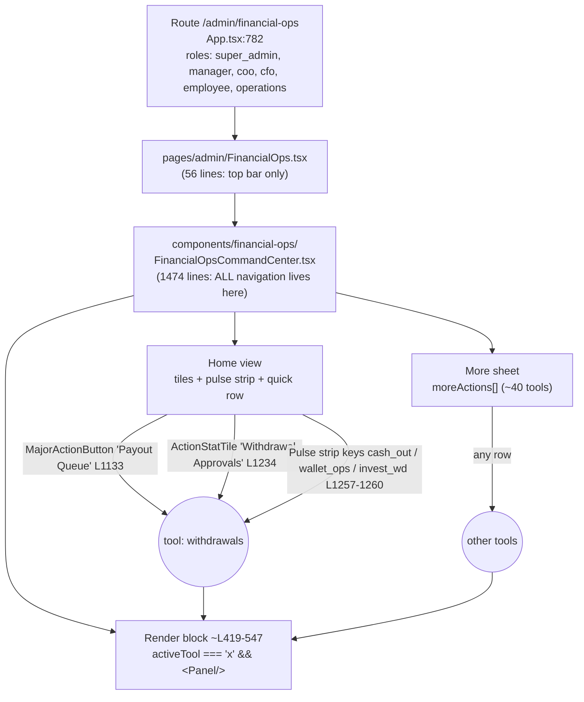
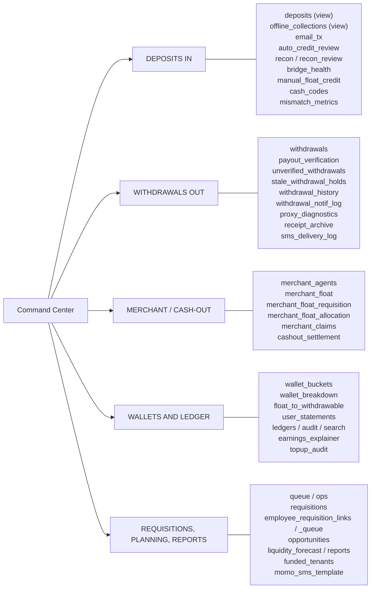
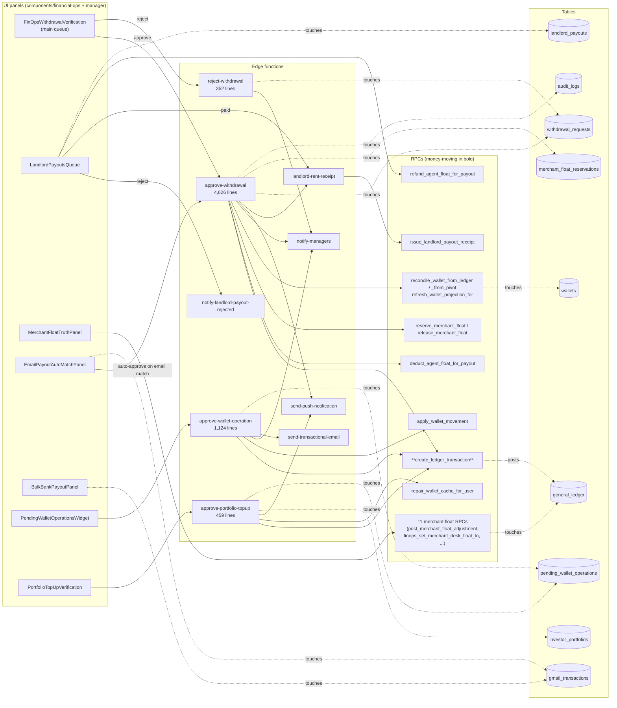

# Map: `/admin/financial-ops` (Financial Ops console)

Purpose of this file: when something breaks or moves, find **which line of the chain** is the problem without reading 100 files.

How it was built: static scan of `src/` and `supabase/functions/` (looks for `.rpc('x')`, `functions.invoke('x')`, `.from('x')`, and the hooks each panel imports).
**Limits:** it cannot see dynamically-built names, database triggers, or cron jobs that fire on their own. `supabase/migrations/` does not faithfully reflect production (see `CLAUDE.md`), so RPC bodies are *not* mapped here. Treat this as the UI → edge function → RPC/table skeleton, not the whole truth.

Conventions: `UI` = React panel, `EF` = edge function, `RPC` = Postgres function, `TBL` = table.

---

## 1. Layer 1: how you get to a tool (routing and entry points)

**What this means for your "I moved the withdraw button" problem:** the Withdrawals tool is reachable from **three places inside this one file** (two tiles, plus one pulse-strip handler that routes three different keys; all call `onOpenTool('withdrawals')`) and is rendered at one place (`activeTool === 'withdrawals'`, L455). Moving or removing a button only changes how you *reach* the tool. It cannot change what the tool does. If a button vanished, check those three call sites first. If the tool misbehaves, skip the buttons and go to section 3.

---

## 2. Layer 2: the 42 tools grouped by job

Rule of thumb: **only G1, G2, G3 and a few G4 tools move money.** Most of G4 and G5 are read-only views, so a bug there cannot move a shilling.

---

## 3. Layer 3: the Withdrawals tool, end to end (the one that matters most)

`activeTool === 'withdrawals'` renders 7 panels in this order. Solid arrows = a call found in code. Dotted arrows = the file touches that table or the RPC is assumed to post there (RPC bodies are not read; see the limits above).

### Blast radius: "if X breaks, what else is damaged?"

| If this breaks | These Withdrawals panels stop working | Also hit outside this tool |
|---|---|---|
| `approve-withdrawal` | Main queue approve **and** email auto-match (two panels share it) | Anything else that calls it (grep `functions.invoke('approve-withdrawal'`) |
| `reject-withdrawal` | Main queue reject only | `agent_landlord_float` and `landlord_payouts` rows (reject-withdrawal touches both) |
| `create_ledger_transaction` (RPC) | **Three** edge functions: approve-withdrawal, approve-wallet-operation, approve-portfolio-topup, so queue, wallet ops and top-up verification all fail together | Every other ledger posting in the app. This is the single biggest shared piece |
| `notify-managers` | No panel breaks, but approve/reject/wallet-op lose manager alerts | |
| `landlord-rent-receipt` | Landlord payout "paid" receipts, **and** approve-withdrawal calls it when a landlord payout is settled | |
| `withdrawal_requests` table | In Withdrawals: main queue, email auto-match, merchant float truth | 7 of 42 tools touch it: withdrawals, queue, email_tx, merchant_claims, merchant_agents, merchant_float, receipt_archive |
| `general_ledger` table | Merchant float truth, topup_audit, search, recon, wallet_breakdown, user_statements, earnings_explainer, merchant_agents, merchant_float, email_tx | 10 of 42 tools touch it |

### Where to look first

| Symptom | Start at |
|---|---|
| Button missing or in the wrong place | Section 1 call sites in `FinancialOpsCommandCenter.tsx` (L1133, L1234, L1257-1260) |
| Panel is blank or says "failed to load" | `lz(...)` import line for that panel (L126-176), then its `ToolErrorBoundary` message |
| Approve click does nothing or errors | `approve-withdrawal` logs, then `create_ledger_transaction` |
| Approved but wallet balance wrong | `reconcile_wallet_from_ledger` / `refresh_wallet_projection_for` (wallet projection), then `/cfo/phantom-drift/:userId` |
| Approved but no SMS/email/push | `notify-managers`, `send-push-notification`, `smsDeliveryLog` (SMS Delivery Log tool) |
| Merchant float number disagrees with ledger | `MerchantFloatTruthPanel` → `get_merchant_float_ledger_variance` |
| Request stuck, user balance hidden | Stale Withdrawal Holds tool → `get_stale_withdrawal_hold_queue` / `cfo_reconcile_stale_withdrawal` |

---

## 4. Findings worth knowing (from building this map)

1. **`approve-withdrawal` is 4,626 lines in one file** and touches 24 tables, 11 RPCs, SMS, WhatsApp, email, push, OCR of payout proofs and merchant float reservations. Almost every "where did it break?" question about payouts passes through it. Splitting it by responsibility (verify → settle → ledger → notify) is the highest-value refactor for debuggability.
2. **`FinancialOpsCommandCenter.tsx` is 1,474 lines and owns all navigation.** Entry points are duplicated (five routes into Withdrawals from three code locations), so a button change is easy to get half-done.
3. **`create_ledger_transaction` is the choke point.** Three approval functions funnel through it, so test it first when several different approvals fail at once.
4. **Auth noise:** the scanner reports `otp-login` and `is_fraud_identifier_blocked` as shared by 10 tools. That is only because those panels import `useAuth`. It is not money logic, so ignore it in blast-radius reading.
5. **Not verified here:** `BulkBankPayoutPanel` shows only table reads in code, yet `auto-settle-bulk-bank-payout` and `reconcile-bulk-bank-payout-stuck` exist as edge functions. They are probably cron-driven and invisible to the UI map. Confirm in the production cron list.

## 5. Next dashboards to map (in order I'd do them)

1. `/cfo/dashboard` (money oversight: reconciliation, drift, direct credit)
2. `/admin/dashboard`
3. `/coo/dashboard`
4. `/ceo/dashboard`
5. Deposits-in side of this console (G1), the Gmail → bridge → wallet chain
